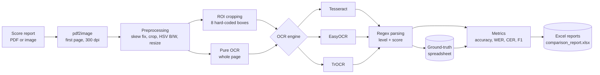
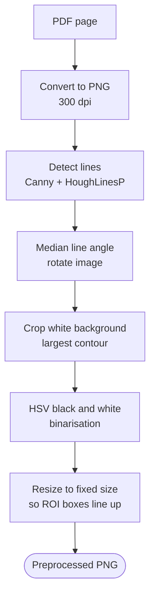
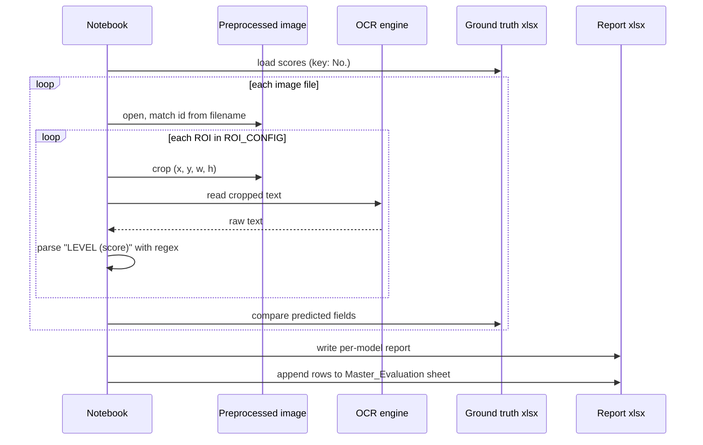

<div align="center">

# OCR English Proficiency Verification

**Reading KMITL-TEP score reports with OCR, and measuring which engine and which strategy reads them best.**

    

</div>

Senior project at KMITL (Faculty of Information Technology). The goal is to replace manual checking of English proficiency score reports (used as a graduation requirement) with an OCR pipeline that turns a score-report image into structured fields.

> **Status: research notebooks, not a deployed app.** This repository contains Google Colab / Jupyter notebooks, sample images and result spreadsheets. There is no `requirements.txt`, no `main.py` and no FastAPI or Flask code in the repository. Earlier versions of this README described a FastAPI dashboard and a `uvicorn main:app` command; I could not find that code here, so it is listed under "Not in this repository" below. The reported accuracy is measured on the project's own KMITL-TEP pilot set (13 fields per document), not on an independent benchmark.

Last updated: 2026-11-03.

---

## Contents

- [Summary in Thai](#summary-in-thai)
- [Problem](#problem)
- [What the notebooks actually do](#what-the-notebooks-actually-do)
- [Repository layout](#repository-layout)
- [Tech stack](#tech-stack)
- [Pipeline architecture](#pipeline-architecture)
- [Flow 1: Preprocessing](#flow-1-preprocessing)
- [Flow 2: Boxing OCR extraction and evaluation](#flow-2-boxing-ocr-extraction-and-evaluation)
- [Evaluation results](#evaluation-results)
- [How to reproduce](#how-to-reproduce)
- [Limitations and privacy](#limitations-and-privacy)
- [Not in this repository](#not-in-this-repository)
- [Presentations and citation](#presentations-and-citation)
- [Author](#author)

## Summary in Thai

โครงงานนี้ใช้ OCR อ่านใบรายงานผลสอบภาษาอังกฤษ (หลักคือ KMITL-TEP) เพื่อดึงข้อมูลเป็นฟิลด์ เช่น ชื่อ, Application No., วันที่สอบ และคะแนน/ระดับของ Grammar, Reading, Speaking, Writing และคะแนนรวม แล้วเปรียบเทียบเอนจิน Tesseract, EasyOCR และ TrOCR ในสองแนวทาง คือ "Pure OCR" (อ่านทั้งหน้า) กับ "Boxing OCR" (ตัดกรอบตำแหน่งแต่ละฟิลด์ก่อนอ่าน) ผลคือแนวทาง Boxing ให้ความแม่นยำเฉลี่ยประมาณ 99.6-99.8% บนชุดทดสอบของโครงงาน ส่วน Pure OCR ต่ำกว่ามาก รีโพนี้เป็นโน้ตบุ๊กวิจัยบน Google Colab ไม่ใช่เว็บแอปที่พร้อมใช้งาน

## Problem

Graduation qualification at the faculty requires checking score reports (for example KMITL-TEP) by hand. Staff must read each report, find the name, application number, test date and the per-skill scores, and compare them with the criteria. This is slow and error-prone. The report images also arrive rotated, skewed or on white backgrounds, which makes a naive "run OCR on the whole page" approach unreliable.

## What the notebooks actually do

1. Convert the source PDF (first page only, 300 dpi) to PNG with `pdf2image`.
2. Correct skew and rotation (Hough line transform, median angle), crop white background, convert to black and white in HSV space, and resize to a fixed size.
3. Extract eight regions of interest per report: `name`, `application_no`, `test_date`, `overall_score`, `grammar`, `reading`, `speaking`, `writing`. The ROI rectangles are hard-coded `(x, y, w, h)` pixel coordinates for the KMITL-TEP template (`ROI_CONFIG` in the notebooks).
4. Run OCR on each cropped box (Tesseract with `--oem 3 --psm 7`, EasyOCR, or TrOCR `microsoft/trocr-base-printed`).
5. Parse skill fields of the form `B1 (17)` into a level and a score with a regex (`parse_level_and_score`), which also repairs common confusions such as `I`/`l` read as `1`.
6. Compare every field with a ground-truth spreadsheet and compute accuracy, WER, CER and F1 with `jiwer` and pandas; write per-model Excel reports and a master comparison sheet.

Supporting experiments:

| Notebook | Purpose |
|---|---|
| `Toeic_In4_Extraction.ipynb` | Trains and evaluates a YOLOv8 detector for field boxes on TOEIC certificates, then runs `pytesseract` on the detected boxes. Comments are in Vietnamese and dataset paths point to a `CS114` folder, so this notebook looks adapted from external course material (ASSUMPTION; verify provenance before citing). |
| `fine_tune_Tong.ipynb` | Optuna hyper-parameter search for YOLOv8s, YOLOv8n and YOLO11n using Ultralytics. |
| `image_alignment.ipynb` | Aligns a scanned form to a reference template using ORB features, brute-force Hamming matching and a homography (OpenCV). |
| `finetune/*.ipynb` | Course labs on augmentation and transfer learning (not part of the OCR pipeline). |

## Repository layout

```
Senior-Project-OCR/
├── finish version4/
│   ├── Finish_version.ipynb              Final pipeline: PDF->PNG, preprocessing, Tesseract/EasyOCR/TrOCR, metrics, charts
│   ├── Ktep-automate-final.ipynb         Automated variant of the final pipeline (Pure and Boxing Tesseract)
│   ├── excel/                            Per-model reports + comparison_report.xlsx + ground-truth scores
│   └── *.png                             Sample rotated / corrected report images
├── lastest_ktep.ipynb                    Earlier iteration of the pipeline
├── auto_ktep.ipynb, ktep_oldversion.ipynb   Older automation iterations
├── Toeic_In4_Extraction.ipynb            YOLOv8 + Tesseract on TOEIC certificates
├── fine_tune_Tong.ipynb                  YOLO tuning with Optuna
├── image_alignment.ipynb                 ORB + homography alignment
├── finetune/                             Course labs (augmentation, transfer learning)
├── *.pdf                                 Published paper, report and slides
├── k-tep.jpg, toeic-ex.jpeg, example-of-ielts-test-report-form.avif   Sample report images
└── README.md
```

## Tech stack

| Layer | Tools (taken from the notebooks) |
|---|---|
| Runtime | Google Colab, Google Drive for data and outputs |
| Image processing | OpenCV (Canny, Hough lines, contours, ORB), NumPy, Pillow, `pdf2image` + poppler |
| OCR engines | Tesseract via `pytesseract`, EasyOCR, TrOCR (`microsoft/trocr-base-printed`, Hugging Face Transformers + PyTorch) |
| Detection experiments | Ultralytics YOLOv8 / YOLO11, Optuna |
| Evaluation | `jiwer` (WER, CER), pandas, matplotlib, seaborn, Excel (xlsx) reports (the F1 computation was not inspected line by line; the old README listed scikit-learn for it) |
| Experiment dropped | Keras-OCR (dependency conflict with NumPy 2, documented in the notebook) |

<p align="center">
  
</p>

## Pipeline architecture



## Flow 1: Preprocessing



## Flow 2: Boxing OCR extraction and evaluation



## Evaluation results

The table is the average over the 13 evaluated fields (name, application number, test date, and level and score for grammar, reading, speaking, writing, plus total level and total score) on the KMITL-TEP pilot set. I recomputed the mean accuracy per model and approach from `finish version4/excel/comparison_report.xlsx` (sheet `Master_Evaluation`, 78 rows) and it matches the values below. Per-field values are in that sheet.

| Model | Approach | Accuracy (%) | WER (%) | CER (%) | F1-score (%) |
|---|---|---|---|---|---|
| EasyOCR | Boxing | 99.75 | 0.25 | 0.16 | 99.79 |
| EasyOCR | Pure | 77.17 | 22.83 | 22.71 | 86.30 |
| Tesseract | Boxing | 99.77 | 0.23 | 0.17 | 99.82 |
| Tesseract | Pure | 81.80 | 18.20 | 15.22 | 86.89 |
| TrOCR | Boxing | 99.63 | 0.37 | 0.18 | 99.67 |
| TrOCR | Pure | 0.00 | 100.00 | 100.00 | 0.00 |

Reading the numbers:

- Cropping the known field regions first (Boxing) is what makes the difference: about 99.6-99.8% versus 77-82% for whole-page OCR.
- TrOCR is a single-line recogniser. Fed a whole page it fails completely (0.00); the notebook explains this and uses a hybrid in which EasyOCR finds lines first.
- The ROI boxes are fixed pixel coordinates for one template, so the high Boxing scores depend on the preprocessing producing the same layout. The pilot set is small and from one template; do not read these numbers as general OCR accuracy.

## How to reproduce

The notebooks are written for Google Colab with data on Google Drive. Paths such as `/content/drive/MyDrive/lastest-ktep/...` are hard-coded and the original dataset is not in this repository, so you must supply your own PDFs and ground-truth sheet.

1. Open `finish version4/Finish_version.ipynb` in Colab.
2. Run the setup cells. They use `apt install tesseract-ocr libtesseract-dev` and `pip install` for `pdf2image`, `pytesseract`, `easyocr`, `jiwer`, `transformers` and others (see the first code cells for the exact list).
3. Mount Drive and edit the folder constants (`PDF_FOLDER`, `IMAGE_FOLDER`, `IMAGE_DIR`, `GROUND_TRUTH_PATH`, `ROI_CONFIG`) to match your data. `ROI_CONFIG` must match the size of your preprocessed images; `Ktep-automate-final.ipynb` uses a different coordinate set from `Finish_version.ipynb`.
4. Run the cells top to bottom. Reports are written to the `excel` folder you configured.

No automated tests exist in this repository; evaluation is the notebook metrics above.

## Limitations and privacy

- Score reports contain personal data (name, application number, scores). Under Thai PDPA, process real reports only with a lawful basis, and do not commit real reports or ground-truth sheets to a public repository. The sample images and spreadsheets committed here come from the pilot study; check that they contain no identifiable real data before reusing them (ASSUMPTION: I did not open the images or spreadsheets' personal columns).
- Template-specific: ROI coordinates are hard-coded for KMITL-TEP. Other templates (TOEIC, IELTS) need their own regions or a learned detector; only an experimental YOLO notebook exists for TOEIC and only a sample image exists for IELTS.
- OCR is probabilistic. A production system would need confidence thresholds and human review for low-confidence fields before any pass/fail decision.
- Notebooks install packages and mount Drive at run time; pin versions before relying on results.

## Not in this repository

Items that earlier README versions claimed and that I could not find in the files:

- A FastAPI/Flask web dashboard, `main.py`, `requirements.txt` and a `uvicorn` entrypoint.
- A rule-based verification module that outputs a PASS/FAIL JSON against graduation criteria (the "Example output" JSON in older versions was illustrative; no code producing it was found).
- IELTS support (only a sample image is present).
- Database storage (MySQL/SQLite) and deployment configuration.

Planned ideas from the original README (not implemented): CU-TEP and TU-GET support, Thai/English recognition, integration with student systems, Docker or AWS Lambda deployment.

## Presentations and citation

- Presentation Project 1: <https://canva.link/qj231zk1nqbb44d>
- Presentation Project 2: <https://canva.link/2kb5cqji5elbsfc>
- Paper and report PDFs are in the repository root (`2.2_Automated_Verification_of_English_Proficiency_Test_Scores_Using_OCR_for_Graduation_Qualification (1).pdf`, `final 8page.pdf`, `BaoCaoDoAn.pdf`).

> Jaimetha, N. (2025). *Automated Verification of English Proficiency Test Scores Using OCR for Graduation Qualification.* King Mongkut's Institute of Technology Ladkrabang (KMITL), Faculty of Information Technology.

## Author

**Nattakamon Jaimetha (jdiih)**, Data Science & Business Analytics, KMITL.
GitHub: [Dxrksvng](https://github.com/Dxrksvng) · LinkedIn: [nattakamon-jaimetha](https://www.linkedin.com/in/nattakamon-jaimetha) · Email: nattakamon0208@gmail.com
